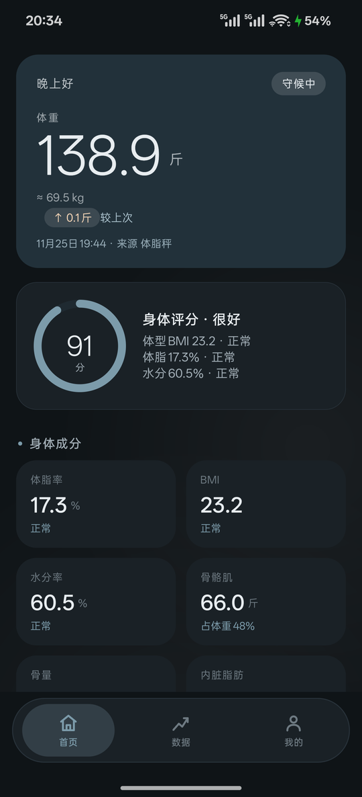
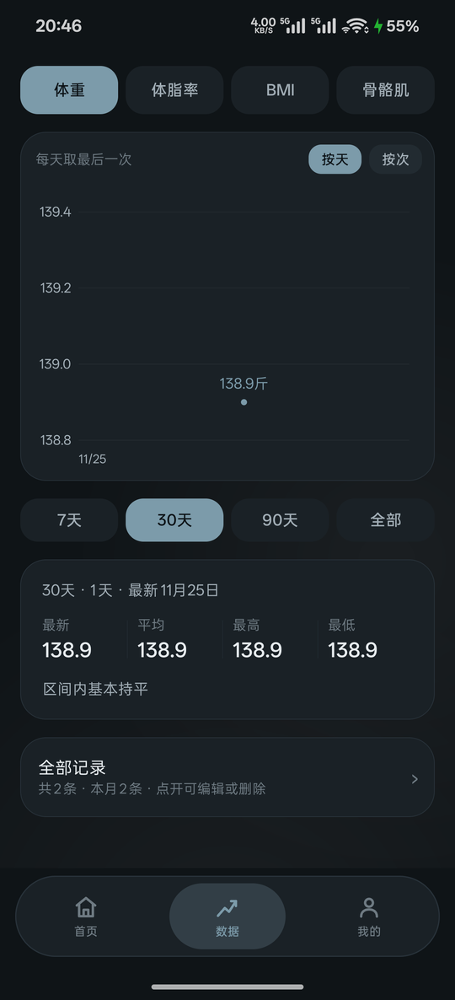
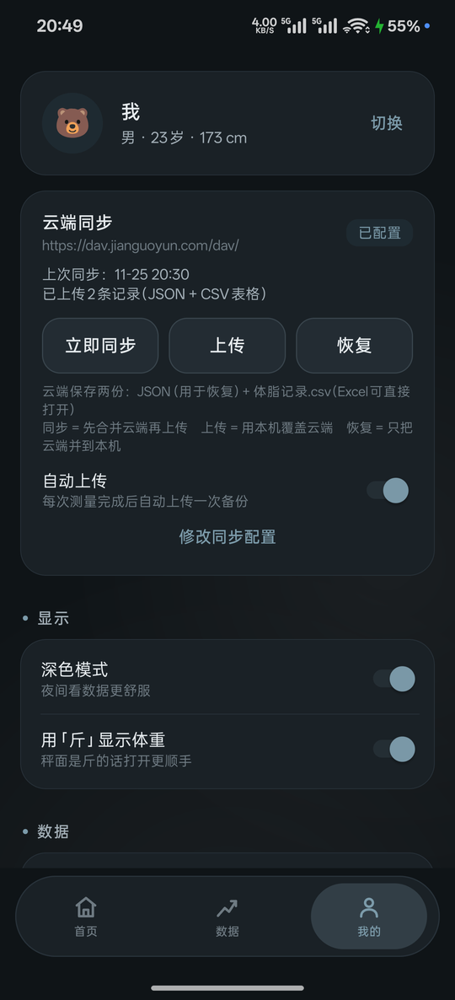

# 体脂秤 · ScaleLink

一个**纯 Java、零第三方依赖、BLE 广播直读**的安卓体脂秤 App，用来替代又卡又重的京东健康。

不需要登录、不需要联网（云端同步可选）、不申请账号，装上就能称。

[](https://github.com/niu-15/ScaleLink/actions/workflows/build.yml)
[](https://github.com/niu-15/ScaleLink/releases/latest)
[](https://developer.android.com/about/versions/lollipop)
[](https://developer.android.com/about/versions/14)
[](https://openjdk.org/projects/jdk/17/)
[](LICENSE)
[](#为什么零依赖)

<p align="center">
  
  
  
</p>

---

## 这个项目最核心的一条发现

> **这台秤根本不需要"连接"。**

它的蓝牙广播标着 `connectable=false`，任何 `connectGatt()` 都会在链路层超时（HCI 0x08）。但**实时体重、阻抗、秤内部时钟全都在厂商广播数据里**——扫描即测量。

```
10 FF C0 [cnt] [W1 W2] [I1 I2] [hh mm ss] [MAC × 6]
        ↑         ↑         ↑
      标记    体重大端    阻抗大端
             ÷100=kg    ÷10=Ω
```

所以那些"连不上秤"的教程、各种配对重试、GATT 服务探测，在这台设备上全是无用功。完整实测记录见 **[tools/PROTOCOL-captured.md](tools/PROTOCOL-captured.md)**（含抓包原文、逐字段解释、以及一次把温湿度计误判成体脂秤的事故复盘）。

## 功能

**测量**

- 广播直读，无需配对，靠近即测
- 测量闸门（`MeasureGate`）：连续 4 次读数相差 ≤0.3kg 判定站稳，静默 2.2 秒结算一次，杜绝重复入库
- 广播计数器去重 + 丢包检测
- 支持手动录入、记录编辑与删除

**身体成分**

- 体脂率、BMI、水分率、骨骼肌、骨量、内脏脂肪、基础代谢、去脂体重
- 体脂率采用 Deurenberg 公式（`1.20×BMI + 0.23×年龄 − 10.8×性别 − 5.4`）再用生物电阻抗做小幅修正（限幅 ±2.5%），骨骼肌按去脂体重 ×0.575
- 换身高会**自动重算全部历史**，不会出现"同一体重两个体脂率"
- 支持手动校准偏移

**趋势与记录**

- 折线图支持体重 / 体脂率 / BMI / 骨骼肌四个指标
- 7 天 / 30 天 / 90 天 / 全部，Y 轴自动取整齐步长，X 轴首中尾三档刻度
- **按天 / 按次**切换：按天取当天最后一次，避免一天称三次把曲线拉成锯齿
- 区间统计（最新 / 平均 / 最高 / 最低 / 区间变化）
- 全部记录可折叠展开，点开可改备注或删除

**其他**

- 云端同步：WebDAV（坚果云等），上传 JSON（用于恢复）+ **CSV（Excel 直接打开）**，支持自动上传
- 斤 / kg 单位切换（秤面若是斤，用斤显示更顺手）
- 深色 / 浅色主题，40 个表情头像
- 首次安装先问性别、年龄、身高——不然 BMI 和体脂率没有意义

## 支持哪些秤

内置 5 种协议解析器，按 GATT 服务 UUID 自动探测：

| 协议 | 特征 |
|---|---|
| 广播直读 | 厂商广播 `0xFF`，标记字节 `0xC0`，末尾 MAC 校验 |
| `XiaomiProtocol` | `ebe0ccb0` / `0xFE95`（小米体重秤方案，本项目实测机型即此方案 ODM 贴牌） |
| `BcsProtocol` | 标准体重服务 `0x181D` / `0x2A9D` |
| `Ffb0Protocol` / `Faa0Protocol` / `AfuProtocol` | 其他厂商私有协议 |

**实测通过的只有一种**：天晟 × 京东健康体脂秤（小米方案 ODM，广播型）。其余协议是通用实现，没有真机验证过——如果你手上有别的秤，欢迎抓包提 issue 补上。

## 直接装

懒得编译的话，直接到 **[Releases](https://github.com/niu-15/ScaleLink/releases/latest)** 下载 `ScaleLink-3.15.apk`（340 KB，要求 Android 5.0+），仓库里也留了一份：[dist/ScaleLink-3.15.apk](dist/ScaleLink-3.15.apk)。

装之前先确认你的秤是广播型的——打开 App 站在秤上，如果首页体重能跳到正确数字，就是它。

## 构建

要求：JDK 17、Android SDK（compileSdk 34）。

```bash
git clone https://github.com/niu-15/ScaleLink.git
cd ScaleLink
./gradlew assembleDebug
# 产物：app/build/outputs/apk/debug/app-debug.apk
```

也可以直接用 Android Studio 打开工程。

首次打开会要求蓝牙权限（Android 12+ 需要「附近的设备」；Android 11 及以下还需要定位权限，且系统定位开关要打开——这是系统限制，不是 App 在偷偷定位）。

### 为什么零依赖

除 Android Framework 外**没有任何第三方库**，连 `androidx` 都只用来拿 `Context` 之类的便利类。好处：

- 包体 340 KB，冷启动快
- 完全离线可编译，不受某厂仓库抽风影响
- 每个 UI 组件（环形图、柱状图、趋势图、导航栏）都是自绘 `View`，没有 Material 主题的重样式负担

代价是要自己写样式系统。所有颜色集中在 `ui/Theme.java`，改配色只改这一个文件。

## 目录结构

```
app/src/main/java/com/scale/link/
├── MainActivity.java          外壳、权限、弹窗、称重结算（最大的一个文件）
├── ble/BleManager.java        扫描、广播解析、GATT 连接兜底
├── protocol/                  5 种协议解析 + 体成分算法 + 称重闸门
│   ├── BodyComposition.java   体脂 / 骨骼肌 / BMR 计算
│   ├── MeasureGate.java       站稳判定、聚类、去重
│   └── *Protocol.java
├── data/DbHelper.java         SQLite 建表、迁移、历史重算
├── model/                     Measurement / UserProfile
├── page/                      HomePage / DataPage / ProfilePage
├── sync/                      WebDAV 客户端、同步服务、备份
└── ui/                        Theme、自绘组件、卡片工厂
tools/                         图标生成、抓包解析、协议文档
```

> `sync/WebDavClient.java` 值得单独提一句：`HttpURLConnection` 有方法白名单，遇到 `MKCOL` / `PROPFIND` 会直接抛 `ProtocolException`，所以这里用 `Socket` / `SSLSocket` 手写了一套最小 HTTP/1.1 客户端（含 Basic 认证、SNI、chunked 解码、重定向保持原方法）。

## 已知限制

1. **只能在前台称重**。切到别的 App 或锁屏，广播就收不到了。这是当前最大的短板——因为秤不接受连接，只能靠持续扫描。后续计划用前台服务 + 常驻通知解决。
2. **体成分是估算值**。BIA 受水分、进食、时间影响很大，不同厂商算法差异也大，同一台秤和京东健康差 1~2 个百分点是正常的。别把它当医疗数据。
3. **广播没有"稳定位"**。秤不上报"已稳定"，稳定判定是 App 自己根据读数抖动推断的，所以极少数情况下会提前结算。
4. 应用体积小、无崩溃上报，出问题只能靠 logcat。

## 隐私

- 所有数据默认只存本机 SQLite，App 不发起任何后台请求
- 只有你主动开启 WebDAV 后，才会以你的账号上传到你自己的网盘
- 没有统计 SDK、没有广告、没有账号体系
- WebDAV 里存的是明文 JSON / CSV（方便你用 Excel 打开），不要在公共网盘放敏感数据

## 免责声明

本项目与天晟、京东健康、小米均无关联，协议信息来自对自有设备的蓝牙广播观测，仅用于让自己的设备能用起来。请自行判断合规性，因使用本项目产生的任何后果由使用者承担。

不提供任何医疗建议，身体成分数据仅供参考。

## License

[MIT](LICENSE) © ScaleLink contributors

---

如果这个项目帮你甩掉了某个 200MB 的健康 App，给个 ⭐ 吧。
